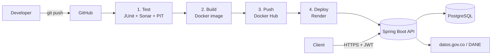

# Tournament Manager API 🎮


[](https://sonarcloud.io/dashboard?id=<ORG>_gestor-torneos)


> Replace `<USER>`, `<REPO>` and `<ORG>` with your real values.

**Live demo:** `https://<your-app>.onrender.com` · **Swagger UI:** `/swagger-ui.html` · **Health:** `/actuator/health`

## Overview

Tournament Manager is a REST API for organising video game tournaments. It is the integrating project of the *Taller de Programación* course at Universidad Manuela Beltrán (UMB), built by a team of three students. It combines everything we learned during the semester: object-oriented design, hexagonal architecture, a relational database, JWT authentication with role-based access control, automated quality gates, security scanning and cloud-native deployment with Docker and GitHub Actions.

## Features

- **JWT authentication and RBAC** with two roles (`ADMIN`, `USER`), brute-force protection and OWASP API Security Top 10 (2023) controls.
- **Tournament CRUD** persisted in PostgreSQL through Spring Data JPA, with validation and a uniform JSON error format.
- **Open-data integration** with two Colombian sources (datos.gov.co and DANE) through the Socrata API, protected by retries with exponential backoff and a circuit breaker.
- **Descriptive analytics** with DuckDB (statistics and top categories).
- **LLM assistant** using zero-shot, few-shot, chain-of-thought and basic RAG prompting (optional, needs `OPENAI_API_KEY`).
- **OpenAPI 3 documentation** with Swagger UI.
- **Quality gates:** JUnit 5 + AssertJ + Mockito, JaCoCo, SonarCloud, PIT mutation testing (≥ 50 %), CodeQL and Dependabot.

## Architecture



```
com.torneos          JWT/RBAC module: auth, security, in-memory tournaments (/api/v1/**)
com.tournamentmanager  Hexagonal module: domain, application (ports), api, infrastructure
                       (JPA, DuckDB, OpenAI, open data, circuit breaker) (/api/**)
```

Both modules run inside one Spring Boot application (`TorneosApplication`). Every endpoint except login, Swagger and the health check requires a valid JWT.

## Endpoints

| Method | Path | Access |
|---|---|---|
| POST | `/api/v1/auth/login` | Public |
| GET | `/actuator/health` | Public |
| GET | `/swagger-ui.html`, `/v3/api-docs` | Public |
| GET | `/api/v1/admin/ping` | `ADMIN` |
| CRUD | `/api/v1/torneos` | `USER` / `ADMIN` (owner or `ADMIN` for edits) |
| CRUD | `/api/tournaments` | `USER` / `ADMIN` |
| POST | `/api/assistant/...` | `USER` / `ADMIN` |
| GET | `/api/opendata/summary?limit=5` | `USER` / `ADMIN` |

```bash
TOKEN=$(curl -s -X POST localhost:8080/api/v1/auth/login \
  -H 'Content-Type: application/json' \
  -d '{"username":"admin","password":"<SEED_ADMIN_PASSWORD>"}' \
  | python3 -c 'import sys,json;print(json.load(sys.stdin)["token"])')

curl -i localhost:8080/api/tournaments -H "Authorization: Bearer $TOKEN"
```

## Run locally with Docker

```bash
git clone https://github.com/<USER>/<REPO>.git && cd <REPO>
cp .env.example .env          # edit the secrets
docker compose up --build
```

The `app` service waits until PostgreSQL is healthy, so there is no start-up race. The API is then available at <http://localhost:8080>.

## Docker image

The `Dockerfile` has two stages. Stage one compiles the project with Maven (dependencies are cached in their own layer); stage two copies only the resulting JAR into a slim JRE image. The container runs as a **non-root user**, defines a `HEALTHCHECK`, and a `.dockerignore` keeps build output, secrets and IDE files out of the build context. The runtime image is Ubuntu-based rather than Alpine because DuckDB ships a native library that needs glibc.

## CI/CD pipeline

Every push to `main` runs four stages:

1. **Test** – build, tests with JaCoCo, SonarCloud quality gate and PIT mutation testing.
2. **Build** – builds the Docker image with BuildKit cache and prints its size.
3. **Push** – publishes the image to Docker Hub tagged `latest` and with the commit SHA.
4. **Deploy** – calls the Render deploy hook and runs a smoke test against `/actuator/health`.

Pull requests run only the first two stages, so nothing is published from unreviewed code.

GitHub secrets: `SONAR_TOKEN`, `DOCKERHUB_USERNAME`, `DOCKERHUB_TOKEN`, `RENDER_DEPLOY_HOOK_URL`, `APP_PUBLIC_URL`.

## Deploy on Render

1. Create a **PostgreSQL** database on Render.
2. Create a **Web Service** from the Docker Hub image `<dockerhub-user>/gestor-torneos:latest`.
3. Set the environment variables below, then copy the service **Deploy Hook** URL into the `RENDER_DEPLOY_HOOK_URL` secret.

| Variable | Description |
|---|---|
| `SPRING_DATASOURCE_URL` | `jdbc:postgresql://<host>:5432/<db>` |
| `SPRING_DATASOURCE_USERNAME` / `SPRING_DATASOURCE_PASSWORD` | Database credentials |
| `JWT_SECRET` | Signing key, 32+ bytes |
| `SEED_ADMIN_PASSWORD` / `SEED_USER_PASSWORD` | Passwords of the demo users |
| `OPENAI_API_KEY` | Optional, enables the LLM assistant |
| `DATOS_GOV_CO_DATASET_ID` / `DANE_DATASET_ID` | Open-data dataset IDs |
| `PORT` | Injected by Render (defaults to 8080) |

## Quality commands

| Goal | Command |
|---|---|
| Tests + JaCoCo coverage | `mvn verify` |
| Mutation testing | `mvn test-compile org.pitest:pitest-maven:mutationCoverage` |
| SonarCloud | `SONAR_TOKEN=... mvn verify org.sonarsource.scanner.maven:sonar-maven-plugin:sonar` |

## Lessons learned

Containerising the application made the environment reproducible: "it works on my machine" became "it works in the image". Splitting the pipeline into stages gave fast feedback and a clear place to look when something failed. GitHub Copilot sped up boilerplate such as workflow YAML, but every suggestion had to be reviewed before we accepted it.

## Documentation

Architecture decisions are in `docs/adr/`, the defence notes in `docs/SUSTENTACION.md`, and the previous Spanish README in `docs/README_GUIA7_ES.md`.

## Team

- Johan Alberto González Cutiva
- Sara Álvarez
- Sergio Castellanos

## License

MIT
